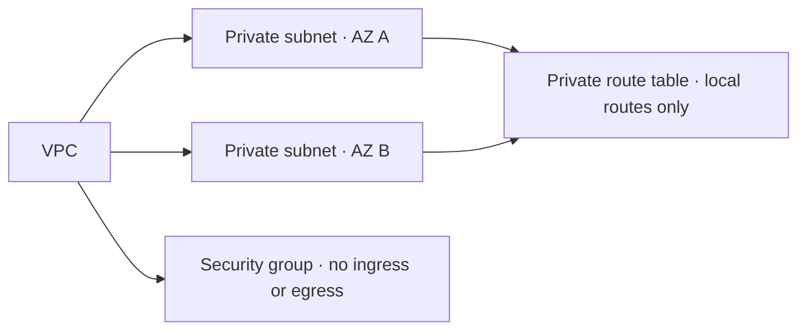

# AWS private network module and lab

A reusable network module plus a small root configuration: one VPC, two private
subnets across distinct availability zones, a private route table, and an isolated
security group. There is no Internet gateway, NAT, compute, or default Internet route.



## Validate without AWS access

```sh
tofu init -backend=false
tofu fmt -check -recursive
tofu validate
tofu test
```

Tests use a mocked AWS provider and plan assertions. They check subnet count,
public-IP assignment, empty egress policy, and invalid-input rejection. They do
not demonstrate AWS deployment, quota availability, or end-to-end connectivity.
The configuration requires Terraform/OpenTofu with provider mocking support.

## Review a real sandbox plan

Copy `terraform.tfvars.example` to a local ignored `.auto.tfvars` file, set your
ownership tags and zones, authenticate to your own sandbox account with temporary
credentials, then run `tofu plan -out=lab.tfplan`. Inspect account, region, CIDR
containment, subnet overlap, AZ availability, tags, and every proposed resource.
Only apply a reviewed plan. See [runbook](RUNBOOK.md) for teardown.

State is local for this lab and ignored by Git. Team use requires a separately
configured encrypted remote backend and locking. No AWS deployment is claimed.
